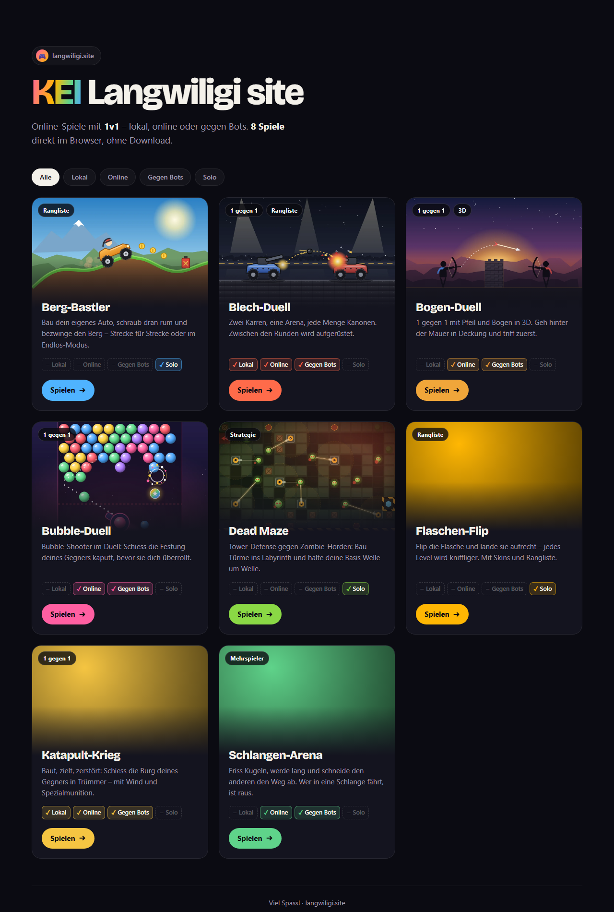

# 🎮 KEI Langwiligi site

**Browser-Spiele für 1 gegen 1 – lokal, online oder gegen Bots. Direkt im Browser, ohne Download.**

👉 **Jetzt spielen: [langwiligi.site](https://langwiligi.site/)**

[](https://langwiligi.site/)

## Spiele

| Spiel | Modi | Worum geht's? |
|---|---|---|
| [Berg-Bastler](https://langwiligi.site/berg-bastler/) | Solo | Bau dein eigenes Auto und bezwinge den Berg. |
| [Blech-Duell](https://langwiligi.site/blech-duell/) | Lokal · Online · Bots | Zwei Karren, eine Arena, jede Menge Kanonen. |
| [Bogen-Duell](https://langwiligi.site/bogen-duell/) | Online · Bots | 1 gegen 1 mit Pfeil und Bogen in 3D. |
| [Bubble-Duell](https://langwiligi.site/bubble-duell/) | Online · Bots | Bubble-Shooter im Duell. |
| [Dead Maze](https://langwiligi.site/dead-maze/) | Solo | Tower-Defense gegen Zombie-Horden. |
| [Flaschen-Flip](https://langwiligi.site/flaschen-flip/) | Solo | Flip die Flasche und lande sie aufrecht. |
| [Katapult-Krieg](https://langwiligi.site/katapult-krieg/) | Lokal · Online · Bots | Schiess die Burg deines Gegners in Trümmer. |
| [SBB Runner](https://langwiligi.site/sbb-runner/) | Solo · Bots · Lokal · Online | Renn über Schweizer Gleise und häng den Kontrolleur ab. |
| [Schlangen-Arena](https://langwiligi.site/schlangen-arena/) | Online · Bots | Friss Kugeln, werde lang, schneide den anderen den Weg ab. |

## Eigenes Spiel hochladen

Jeder kann mitmachen – auch ohne Programmier-Erfahrung mit Git.
**Anleitung: [MITMACHEN.md](MITMACHEN.md)** · Regeln für Spiele: [SPIEL-VORGABEN.md](SPIEL-VORGABEN.md)

Kurz: Spielordner auf GitHub hochladen → automatische Prüfung → nach dem OK ist das Spiel in ca. 1 Minute auf langwiligi.site.

## Wie es funktioniert

```
Freund lädt games/<spiel>/ hoch ──► Pull Request ──► Prüfung (tools/spiel-pruefen.js)
                                         │
                              Besitzer klickt "Merge"
                                         ▼
                 GitHub Actions baut die Startseite (deploy.sh) ──SSH──► Server (nginx)
```

- **Spiele**: reines HTML/CSS/JavaScript, eine `index.html` pro Ordner, kein Build-Schritt.
- **Startseite**: wird beim Hochladen aus `<title>` und den `<meta>`-Angaben jedes Spiels gebaut (`deploy.sh`).
- **Online-Modus & Ranglisten**: eigener kleiner Node.js-Server mit WebSockets (`server/game-hub.js`), im Browser über `games/_shared/hub.js`.
- **Hochladen**: GitHub Actions mit einem SSH-Schlüssel, der auf dem Server nur die Webseite austauschen darf (`server/langwiligi-deploy.sh`).
- **Server**: Ubuntu, nginx, HTTPS mit Let's Encrypt.

## Ordner

| Pfad | Inhalt |
|---|---|
| `games/<spiel-id>/` | Ein Spiel: `index.html`, `cover.webp`, Bilder, Sounds |
| `games/_shared/` | Gemeinsamer Code für alle Spiele (Zurück-Knopf, Online-Funktionen) |
| `server/` | Spiel-Server und Upload-Skript für den Server |
| `tools/spiel-pruefen.js` | Automatische Prüfung neuer Spiele |
| `.github/workflows/` | Prüfung bei Pull Requests, Online-Stellen bei `main` |
