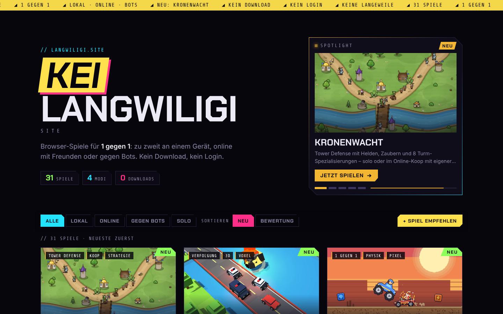

# 🎮 KEI Langwiligi site

**Browser-Spiele für 1 gegen 1 – lokal, online oder gegen Bots. Direkt im Browser, ohne Download.**

👉 **Jetzt spielen: [langwiligi.site](http://46.224.94.231/)**

[](http://46.224.94.231/)

## Spiele

| Spiel | Modi | Worum geht's? |
|---|---|---|
| [2048](http://46.224.94.231/2048/) | Solo | Zahlen zusammenschieben bis zur 2048-Kachel. Original: Gabriele Cirulli (MIT). |
| [3D Bowfight](http://46.224.94.231/bogen-duell/) | Online · Bots | 1 gegen 1 mit Pfeil und Bogen in 3D. |
| [Backgammon](http://46.224.94.231/backgammon/) | Lokal · Online · Bots | Würfeln, ziehen, abtragen – der Brettspiel-Klassiker. |
| [Billard](http://46.224.94.231/billard-duell/) | Lokal · Online | Billard im Duell mit Power-ups. |
| [Bottle-Flip](http://46.224.94.231/flaschen-flip/) | Solo | Flip die Flasche und lande sie aufrecht. |
| [Bubble-Race](http://46.224.94.231/bubble-duell/) | Online · Bots | Bubble-Shooter im Duell. |
| [Bubble-Rivals](http://46.224.94.231/blasen-arena/) | Lokal · Online · Bots | Gegner in Blasen fangen: 8 Level gegen Bots, 1 gegen 1 oder 2 gegen 2 auf Zufallskarten. |
| [Car-Fight](http://46.224.94.231/blech-duell/) | Lokal · Online · Bots | Zwei Karren, eine Arena, jede Menge Kanonen. |
| [Catapult](http://46.224.94.231/katapult-krieg/) | Lokal · Online · Bots | Schiess die Burg deines Gegners in Trümmer. |
| [Clumsy Bird](http://46.224.94.231/clumsy-bird/) | Solo | Flatter durch die Röhren. Original: Ellison Leão (GPL-3.0). |
| [Dame](http://46.224.94.231/dame/) | Lokal · Online · Bots | Springen, schlagen, zur Dame werden. |
| [Dead Maze](http://46.224.94.231/dead-maze/) | Solo | Tower-Defense gegen Zombie-Horden. |
| [Dots and Boxes](http://46.224.94.231/kaesekaestchen/) | Lokal · Online · Bots | Linien ziehen, Kästchen schliessen, Extrazüge holen. |
| [Dreh & Gewinn](http://46.224.94.231/dreh-duell/) | Lokal · Online · Bots | Kugel setzen, Brettviertel drehen, fünf in eine Reihe. |
| [Farbfalle](http://46.224.94.231/farben-duell/) | Lokal · Online · Bots | Deine Zielfarbe bestimmt den Zug des Gegners. |
| [Faust-Duell](http://46.224.94.231/faust-duell/) | Lokal · Online · Bots | Prügel-Duell im Dojo: Schläge, Tritte, Uppercuts. Engine: mk.js von Minko Gechev (MIT). |
| [Festungssturm](http://46.224.94.231/festungs-duell/) | Online | Truppen schicken, Türme bauen, Festung zerstören – in Echtzeit. |
| [Flucht-Schiesserei](http://46.224.94.231/flucht-schiesserei/) | Online · Bots | Wackelige Gauner hüpfen zum Fluchtfahrzeug – über Züge, Flugzeuge und Brücken. |
| [Formenfabrik](http://46.224.94.231/formenfabrik/) | Solo | Formen schneiden, drehen, färben und eine riesige Fabrik automatisieren. Original: shapez von tobspr Games (GPL-3.0). |
| [Fünf gewinnt](http://46.224.94.231/fuenf-gewinnt/) | Lokal · Online · Bots | X gegen O auf dem grossen Brett. |
| [Go](http://46.224.94.231/go/) | Lokal · Online · Bots | Das Umzingelungs-Spiel auf 9×9, 13×13 und 19×19. |
| [Hextris](http://46.224.94.231/hextris/) | Solo | Sechseck drehen, Farben abräumen. Original: Hextris-Team (GPL-3.0). |
| [Hillclimber](http://46.224.94.231/berg-bastler/) | Solo | Bau dein eigenes Auto und bezwinge den Berg. |
| [Kopf voraus!](http://46.224.94.231/kopf-voraus/) | Lokal · Online · Bots · Solo | Pixel-Autoduell mit verrückter Physik. |
| [Kronenwacht](http://46.224.94.231/kronenwacht/) | Solo · Online | Tower Defense mit Helden, solo oder im Online-Koop. |
| [Laserlabyrinth](http://46.224.94.231/laser-duell/) | Lokal · Online · Bots | Spiegel drehen, bis der Laser den Kern trifft. |
| [Mancala](http://46.224.94.231/mancala/) | Lokal · Online · Bots | Das uralte Säspiel mit Steinen und Mulden. |
| [Mauerbauer](http://46.224.94.231/mauer-duell/) | Lokal · Online · Bots | Ans Ziel rennen und dem Gegner den Weg verbauen. |
| [Panzer-Duell](http://46.224.94.231/panzer-taktik/) | Lokal · Online | Rundenbasiertes Panzer-Duell mit Minen und Raketen. |
| [Pfeilhagel](http://46.224.94.231/pfeilhagel/) | Lokal · Online · Bots | Pixel-Bogenduell für bis zu 4: Pfeile sammeln, ausweichen, treffen oder draufspringen. |
| [Reversi](http://46.224.94.231/reversi/) | Lokal · Online · Bots | Steine einschliessen und umdrehen. |
| [Road-Runner](http://46.224.94.231/bleifuss-flucht/) | Lokal · Online · Bots · Solo | Voxel-Verfolgungsjagd mit der Polizei. |
| [SBB Runner](http://46.224.94.231/sbb-runner/) | Solo · Bots · Lokal · Online | Renn über Schweizer Gleise und häng den Kontrolleur ab. |
| [Schach](http://46.224.94.231/schach/) | Lokal · Online · Bots | Gegen einen Bot mit vier Stärken und drei Stilen. |
| [Snake](http://46.224.94.231/schlangen-arena/) | Online · Bots | Friss Kugeln, werde lang, schneide den anderen den Weg ab. |
| [Tic-Tac-Turbo](http://46.224.94.231/ultimate-tic-tac-toe/) | Lokal · Online · Bots | Tic-Tac-Toe im Tic-Tac-Toe. |
| [Ur](http://46.224.94.231/koenigliches-ur/) | Lokal · Online · Bots | 4500 Jahre altes Würfel-Rennspiel. |
| [Vier gewinnt](http://46.224.94.231/vier-gewinnt/) | Lokal · Online · Bots | Steine fallen lassen, vier in eine Reihe bringen. |
| [Weltenbrand](http://46.224.94.231/weltenbrand/) | Online · Bots | Weltkriegs-Strategie in Echtzeit: Wirtschaft, Forschung, Armeen zu Land, Luft und See. |

## Eigenes Spiel hochladen

Jeder kann mitmachen – auch ohne Programmier-Erfahrung mit Git.
**Anleitung: [MITMACHEN.md](MITMACHEN.md)** · Regeln für Spiele: [SPIEL-VORGABEN.md](SPIEL-VORGABEN.md)

Kurz: Spielordner auf GitHub hochladen → automatische Prüfung → nach dem OK ist das Spiel in ca. 1 Minute auf langwiligi.site.

## Wie es funktioniert

```
Freund lädt games/<spiel>/ hoch ──► Pull Request ──► Prüfung (tools/spiel-pruefen.js)
                                         │
                              Besitzer klickt "Merge"
Besitzer lädt direkt auf main hoch ──────┤
                                         ▼
          GitHub Actions: nochmal prüfen ──► Startseite bauen (deploy.sh) ──SSH──► Server (nginx)
```

- **Automatisch online**: Alles, was in `main` landet, wird geprüft und bei ✅ hochgeladen. Bei ❌ bleibt die Webseite unverändert,
  der Fehler steht unter [Actions](https://github.com/xXLOL127Xxtech/langwiligi-site/actions).
- **Von Hand synchronisieren**: [Actions → „Online stellen“ → „Run workflow“](https://github.com/xXLOL127Xxtech/langwiligi-site/actions/workflows/online-stellen.yml)
  (oder lokal `hochladen.cmd`).
- **Spiel-Server**: Änderungen an `server/game-hub.js` spielt der Server beim Hochladen selbst ein und startet sich neu.
  Wurde `server/langwiligi-deploy.sh` geändert, einmal `server-aktualisieren.cmd` doppelklicken.
- **Übersicht (Aufrufe, Bewertungen & Empfehlungen)**: `http://46.224.94.231/api/empfehlungen#SCHLÜSSEL` (Schlüssel in `/var/lib/game-hub/admin-key.txt`).
  Oben die Aufrufe: Startseite heute/gestern/Durchschnitt, Diagramme für Woche, Monat und Jahre (Startseite und alle Spiele zusammen), meistgespielte Spiele.
  Ein Gerät zählt pro Seite höchstens alle 30 Minuten einmal, ohne Cookies. Die Tageszahlen bleiben 60 Tage (`aufrufe.json`),
  der Durchschnitt pro Tag jeder fertigen Woche bleibt für immer (`verlauf.json`), daraus kommt die Jahres-Ansicht.
  Darunter links die Empfehlungen, rechts die Bewertungen mit Verbesserungsvorschlägen, beide löschbar.
  Bewertet wird erst am Rundenende. Nach jeder Änderung an einem Spiel wird nochmal gefragt, die neue Bewertung ersetzt dann die alte desselben Geräts.

- **Spiele**: reines HTML/CSS/JavaScript, eine `index.html` pro Ordner, kein Build-Schritt.
- **Startseite**: Vorlage in `startseite/`, die Spielkarten baut `deploy.sh` beim Hochladen aus `<title>` und den `<meta>`-Angaben jedes Spiels.
  Intro einmal pro Tag, Spotlight (neu / trendet / top bewertet), Sortierung nach „Neu“ oder „Bewertung“.
- **Bewertungen**: Nach der ersten Runde fragt jedes Spiel einmal nach 1–5 Sternen (`games/_shared/back.js`), gespeichert im Spiel-Server.
- **Online-Modus & Ranglisten**: eigener kleiner Node.js-Server mit WebSockets (`server/game-hub.js`), im Browser über `games/_shared/hub.js`.
- **Hochladen**: GitHub Actions mit einem SSH-Schlüssel, der auf dem Server nur die Webseite austauschen darf (`server/langwiligi-deploy.sh`).
- **Server**: Ubuntu, nginx, HTTPS mit Let's Encrypt.

## Ordner

| Pfad | Inhalt |
|---|---|
| `games/<spiel-id>/` | Ein Spiel: `index.html`, `cover.webp`, Bilder, Sounds |
| `games/_shared/` | Gemeinsamer Code für alle Spiele (Zurück-Knopf, Bewertung, Online-Funktionen) |
| `startseite/` | Vorlage, Stil und Skript der Startseite |
| `docs/` | Bilder für README und LinkedIn |
| `server/`, `server-aktualisieren.cmd` | Spiel-Server (Online, Ranglisten, Bewertungen) und Upload-Skript für den Server |
| `tools/spiel-pruefen.js` | Automatische Prüfung neuer Spiele |
| `tools/formenfabrik/` | Bauskript für die Formenfabrik (aus shapez, GPL-3.0) |
| `.github/workflows/` | Prüfung bei Pull Requests, Online-Stellen bei `main` |
